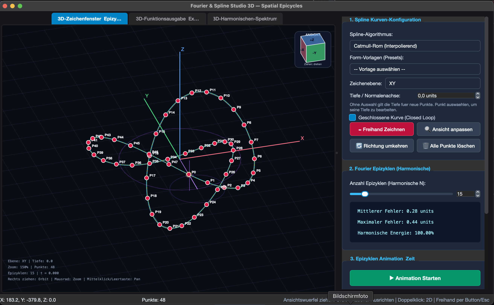

# FourierSplineStudio3D

Ein eigenstaendiges Python-Tool zum interaktiven Zeichnen und Modifizieren von **3D-Splines** sowie zur **Fourier-Zerlegung und Epizyklen-Animation im Raum**. Die Funktionen des 2D-Vorgaengers bleiben erhalten und sind um eine dritte Koordinate erweitert.



## Funktionen

- **Interaktiver 3D-Viewport** mit X-, Y- und Z-Achsen, Koordinatengitter, Zoom und Kameradrehung.
- **Ansichtswuerfel oben rechts**: Ziehen dreht die Kamera frei. Ein Klick auf eine sichtbare Flaeche richtet die Kamera auf diese Achse aus; ein Doppelklick wechselt in die orthogonale 2D-Seitenansicht und waehlt die zugehoerige Zeichenebene.
- **Drei Zeichenebenen**: XY, XZ und YZ. Punkte und Freihandkurven lassen sich auf jeder Ebene anlegen.
- **Freie Tiefenbearbeitung** ueber den Tiefenregler: Neue Punkte werden auf dem eingestellten Ebenen-Offset angelegt; ausgewaehlte Punkte koennen entlang der Ebenennormalen versetzt werden.
- **Spline-Auswahl**: Catmull-Rom, kubischer Spline, B-Spline, Bézier und Polygonzug. Die Algorithmen interpolieren bzw. approximieren alle drei Koordinaten.
- **Vorlagen**: Die 2D-Presets bleiben als Kurven in der XY-Ebene verfuegbar. Dazu kommen 3D-Helix, Kleeblatt-Knoten und Lissajous-Kurve.
- **Fourier-Analyse in 3D**: Die XY-Ebene behaelt die komplexe Fourier-Epizyklenkette des 2D-Vorgaengers; die Z-Koordinate wird als zusaetzliche harmonische Komponente aufgenommen. So entsteht pro Frequenz eine raeumliche Bahn, deren Summe die 3D-Kurve rekonstruiert.
- **Animation und Analyse**: Anzahl der Harmonischen, Start/Pause, Geschwindigkeit, Zeitregler, mittlerer/maximaler 3D-Fehler und rekonstruierter Energieanteil.
- **Ein-/ausblendbare Ebenen**: harmonische Bewegungen, Vektoren, Fourier-Rekonstruktion, Original-Spline, Kontrollpunkte, Spur, Gitter und Achsen.
- **Formel- und Datenexport**: 3D-Vektorform, kartesische x(t)/y(t)/z(t), Python-Skript, LaTeX, parametrische 3D-Kurve, JavaScript sowie Harmonischen-Tabelle.

## Schnellstart auf macOS

Per Doppelklick `start.command` starten oder im Terminal:

```bash
cd FourierSplineStudio3D
./run.sh
```

`run.sh` verwendet oder erstellt eine projektspezifische `.venv` und installiert `numpy` sowie `PyQt5`.

## Maus- und Tastatursteuerung

| Aktion | Steuerung |
| --- | --- |
| Punkt auf aktiver Ebene setzen | Linksklick auf freie Flaeche |
| Kontrollpunkt in der aktiven Ebene bewegen | Linksklick auf Punkt und ziehen |
| Tiefe eines ausgewaehlten Punktes bearbeiten | Tiefenregler im Bedienfeld |
| Punkt loeschen | Rechtsklick auf Punkt oder Punkt auswaehlen und Entf/Backspace |
| Kamera drehen | Rechtsklick auf freie Flaeche oder Ansichtswuerfel anklicken und ziehen |
| Ansichtswuerfel: Achsenansicht | Einfachklick auf eine sichtbare Wuerfelflaeche |
| Ansichtswuerfel: 2D-Seitenansicht | Doppelklick auf eine sichtbare Wuerfelflaeche |
| Zoomen | Mausrad |
| Ansicht verschieben | Mittelklick ziehen oder Leertaste + Ziehen |
| Freihand zeichnen | Freihand-Modus aktivieren und Linksklick halten |
| Freihand-Modus beenden | Button "Freihand beenden" erneut klicken oder Esc druecken |

Die aktuelle Zeichenebene wird im Bedienfeld gewaehlt. Der Tiefenwert entspricht jeweils der uebrigen Koordinate: Z in XY, Y in XZ und X in YZ.

## Projektstruktur

```text
FourierSplineStudio3D/
├── main.py
├── run.sh
├── start.command
├── requirements.txt
├── core/
│   ├── splines.py       # Spline-Algorithmen fuer beliebig viele Koordinaten
│   ├── fourier3d.py     # 3D-DFT, Epizyklen und Rekonstruktion
│   ├── export3d.py      # 3D-Formel- und Quellcodeexporte
│   └── presets3d.py     # Planare und raeumliche Vorlagen
└── ui/
    ├── canvas3d.py      # 3D-Projektion, Zeicheninteraktion und Animation
    ├── control_panel.py
    ├── formula_view3d.py
    ├── harmonics_view3d.py
    └── main_window3d.py
```
